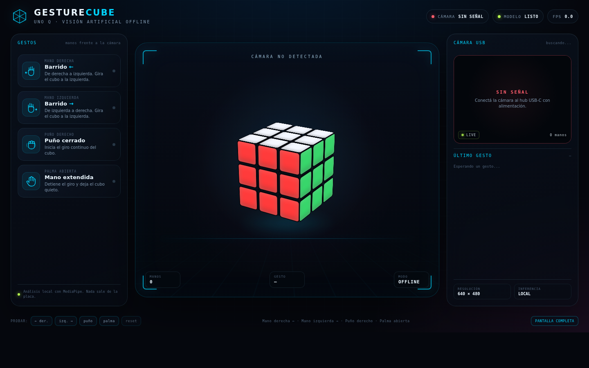
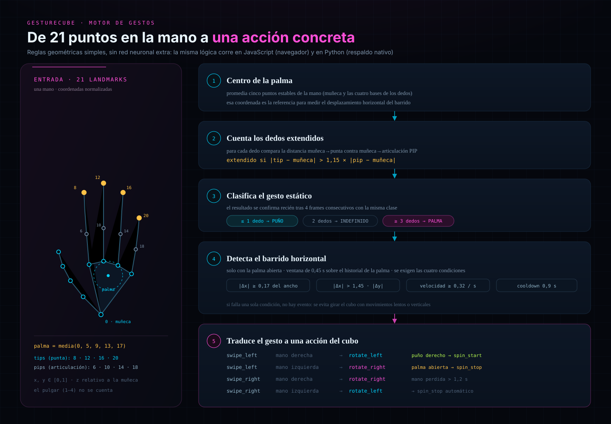
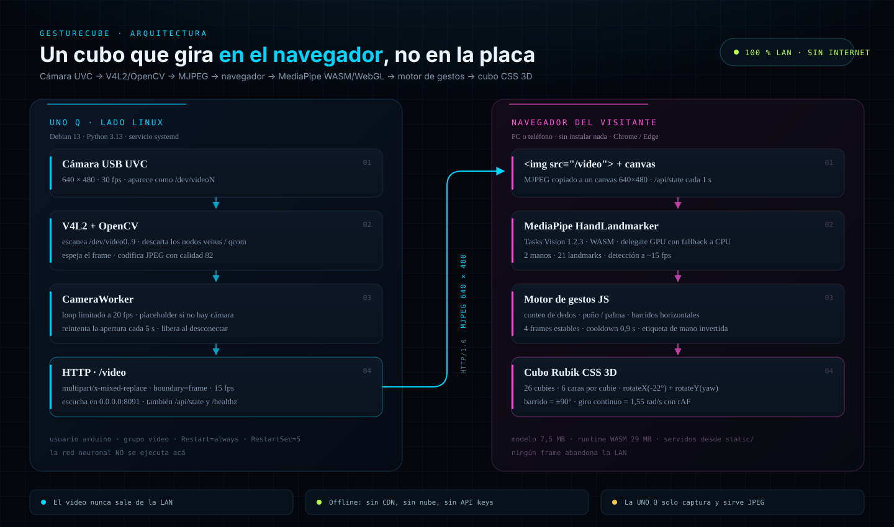
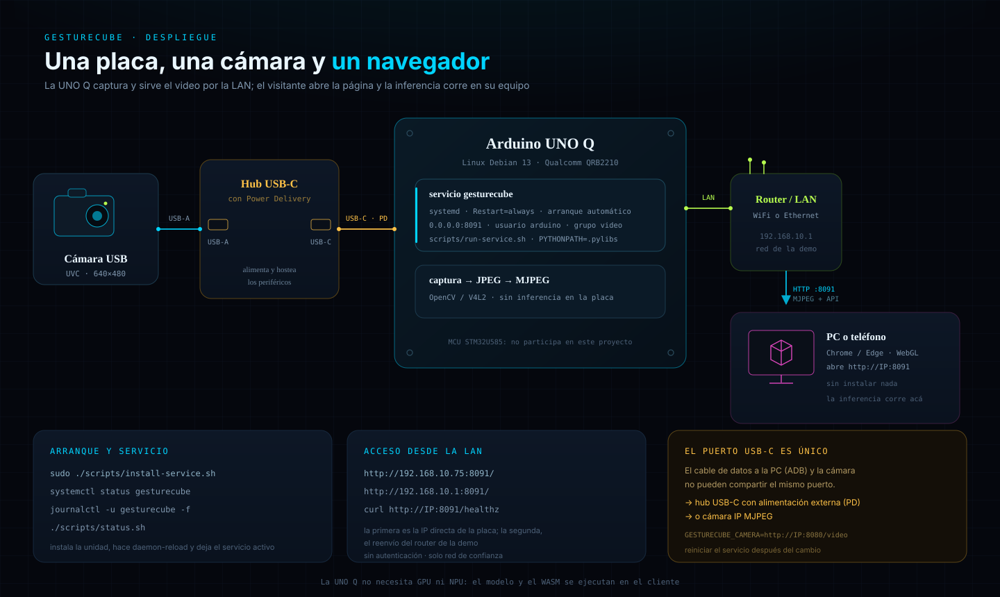

<div align="center">

# GestureCube · Arduino UNO Q

**Un cubo Rubik 3D que gira con la mano. Visión artificial en vivo, 100 % offline, sobre una Arduino UNO Q.**

[](#estado-actual)
[](https://docs.arduino.cc/hardware/uno-q)
[](https://www.python.org/)
[](https://ai.google.dev/edge/mediapipe/solutions/vision/hand_landmarker)
[](#por-qué-la-inferencia-corre-en-el-navegador)
[](#api-http)
[](LICENSE)

</div>



<p align="center"><sub>Captura real del panel: el modelo ya está <b>LISTO</b> en el navegador y la cámara todavía marca <b>SIN SEÑAL</b> porque el único USB-C está ocupado por el cable de datos.</sub></p>

## Estado actual

**Funciona:** el servicio `gesturecube` arranca solo en `0.0.0.0:8091`, sirve la página completa desde la placa, el navegador carga MediaPipe Tasks Vision (`MODELO LISTO`), el cubo CSS 3D gira con eventos y los botones/teclas de prueba mueven el cubo sin cámara. La API HTTP responde y el servicio se reinstala con un script.

**No funciona todavía:** la cámara USB no está detectada. La UNO Q tiene **un solo puerto USB-C** y el cable de datos a la PC lo ocupa; en modo dispositivo ese puerto no puede hostear ni alimentar la cámara. Hace falta un **hub USB-C con Power Delivery** o una **cámara IP** que entregue MJPEG por HTTP. El panel muestra el placeholder `SIN SEÑAL` y el servidor publica un frame de diagnóstico generado con OpenCV.

> El proyecto está terminado en software y arquitectura; el bloqueo es físico. No se documenta como "cámara funcionando" porque no lo está. El código ya soporta las dos salidas: `--camera /dev/videoN` y `--camera http://IP:8080/video`.

## Índice

1. [Qué es GestureCube](#qué-es-gesturecube)
2. [Los gestos](#los-gestos)
3. [Cómo funciona](#cómo-funciona)
4. [Por qué la inferencia corre en el navegador](#por-qué-la-inferencia-corre-en-el-navegador)
5. [Hardware, pinout y conexión](#hardware-pinout-y-conexión)
6. [Software y dependencias](#software-y-dependencias)
7. [Instalación paso a paso](#instalación-paso-a-paso)
8. [Operación en feria](#operación-en-feria)
9. [API HTTP](#api-http)
10. [Configuración y calibración](#configuración-y-calibración)
11. [Estructura del proyecto](#estructura-del-proyecto)
12. [Cómo fue construido](#cómo-fue-construido)
13. [Rendimiento](#rendimiento)
14. [Solución de problemas](#solución-de-problemas)
15. [Limitaciones y seguridad](#limitaciones-y-seguridad)
16. [Referencias](#referencias)
17. [Licencia y autor](#licencia-y-autor)

---

## Qué es GestureCube

Una instalación de visión artificial para ferias: la cámara enfoca al visitante, la placa sirve el video por la LAN y el navegador detecta la mano y mueve un cubo Rubik 3D. El visitante no instala nada ni entrega datos.

La arquitectura reparte el trabajo: la **UNO Q** captura y sirve MJPEG; el **navegador** ejecuta la red neuronal con WebGL/CPU; la **LAN** transporta solo imágenes y JSON. Ningún frame se sube a Internet.

El panel tiene estética de consola de visión artificial: fondo oscuro con rejilla, marco de escaneo, un cubo de 26 cubies con volumen y sombra, tarjetas de gestos que se iluminan, video con esqueleto de la mano, feed del último gesto y botones de prueba.

| Capacidad | Implementación |
|---|---|
| Captura | OpenCV `VideoCapture` sobre V4L2, 640×480, espejado |
| Transporte | MJPEG `multipart/x-mixed-replace` en `/video` |
| Inferencia | MediaPipe Tasks Vision `HandLandmarker`, WASM, GPU→CPU |
| Reglas | Motor geométrico propio en JS (y versión Python de referencia) |
| Visualización | Cubo CSS 3D, 26 cubies, `requestAnimationFrame` |
| Servicio | systemd, usuario `arduino`, grupo `video`, puerto `8091` |
| Offline | Runtime y modelo versionados en `static/` |

## Los gestos

| Gesto | Mano | Acción | Efecto |
|---|---|---|---|
| Barrido derecha → izquierda | Derecha | `rotate_left` | Gira 90° a la izquierda |
| Barrido izquierda → derecha | Izquierda | `rotate_left` | Gira 90° a la izquierda |
| Barrido izquierda → derecha | Derecha | `rotate_right` | Gira 90° a la derecha |
| Barrido derecha → izquierda | Izquierda | `rotate_right` | Gira 90° a la derecha |
| Puño cerrado sostenido | Derecha | `spin_start` | Giro continuo a 1,55 rad/s |
| Palma abierta | Cualquiera | `spin_stop` | Detiene el giro |
| Mano fuera de cuadro | — | `spin_stop` automático | Corta a los ~1,2 s |

La simetría es deliberada: mano derecha barriendo a la izquierda y mano izquierda barriendo a la derecha producen el mismo `rotate_left`, que es la consigna de la demo. Los barridos opuestos producen `rotate_right`.

- **Barrido:** ventana de ~0,45 s sobre la palma; `|dx| ≥ 0,17` del ancho, `|dx| > 1,45·|dy|`, velocidad ≥ 0,32/s y cooldown de 0,9 s.
- **Dedos:** se comparan punta y articulación PIP contra la muñeca; si la punta está >15 % más lejos, el dedo está extendido. El pulgar no se cuenta.
- **Puño/palma:** ≤1 dedo es puño; ≥3 es palma; 2 queda indefinido. Se confirma tras 4 frames estables.
- **Giro:** solo el puño derecho lo inicia; la palma lo detiene; si la mano desaparece, se corta solo.

**Qué gira:** el cubo completo alrededor del eje vertical (`targetYaw ± π/2`). No resuelve un Rubik ni mantiene estado de piezas; es una visualización 3D, no un simulador.




## Cómo funciona

### Principio físico

```mermaid
flowchart LR
    CAM["Cámara USB UVC<br/>640×480 · 30 fps"] -->|V4L2 /dev/videoN| CV["OpenCV VideoCapture<br/>espeja el frame"]
    CV -->|JPEG q=82| MEM["Último frame en memoria"]
    MEM -->|multipart/x-mixed-replace| MJPEG["GET /video<br/>MJPEG 15 fps"]
    MJPEG -->|HTTP :8091 · LAN| IMG["elemento img /video<br/>navegador"]
    IMG --> CANVAS["Canvas 640×480"]
    CANVAS --> MP["MediaPipe HandLandmarker<br/>WASM · WebGL / CPU"]
    MP -->|21 landmarks| RULES["Motor de gestos JS<br/>dedos · puño/palma · barridos"]
    RULES -->|rotate / spin| CUBE["Cubo Rubik CSS 3D<br/>26 cubies · yaw"]
```

La cámara UVC entrega fotogramas por USB; Linux los expone como V4L2 (`/dev/videoN`). OpenCV abre el dispositivo, pide 640×480, lee, espeja y recodifica en JPEG. Cada JPEG se publica en memoria y se envía como parte de un stream `multipart/x-mixed-replace`. El navegador lo recibe en un ``, copia el frame a un canvas y llama a `HandLandmarker.detectForVideo()`. MediaPipe devuelve 21 landmarks normalizados (x, y, z) y la etiqueta `Left`/`Right` por mano. El motor de gestos convierte esos puntos en eventos y el cubo anima su `yaw` con CSS 3D.



Fuera del bucle visual hay dos caminos: `GET /api/state` cada 1 s (solo para saber si la cámara está online) y `POST /api/demo/<acción>` (para disparar eventos desde `curl` o automatización).




### Qué hace cada lado

| Tarea | UNO Q | Navegador |
|---|---|---|
| Abrir cámara, espejar, comprimir | Sí | No |
| Servir MJPEG | Sí | Consume |
| Ejecutar la red neuronal | **No** | **Sí** |
| Reglas de gestos | Solo si el motor nativo estuviera disponible | **Sí** |
| Animar el cubo | No | Sí |
| Guardar video | No | No |

La placa queda liviana: captura y sirve sin competir con una inferencia pesada. Ese es el corazón del diseño.

## Por qué la inferencia corre en el navegador

No es un fallback temporal; es una decisión de arquitectura.

1. **El CPU no soporta los wheels nativos.** El QRB2210 es un ARMv8.0 Cortex-A53 **sin LSE**. Los wheels aarch64 de MediaPipe 1.2.3 y 1.0.0 están compilados con LSE y abortan:
   ```text
   FATAL ERROR: This binary was compiled with lse enabled, but this feature is not available on this processor
   ```
   MediaPipe 0.10.x no publica wheels cp313 aarch64. Compilar desde fuente era posible pero caro; se movió la inferencia.
2. **El navegador tiene mejor hardware.** GPU, WebGL y CPU modernos del visitante. MediaPipe corre en WASM y detecta a ~15 fps.
3. **Privacidad.** El video va de la cámara a la placa y de la placa al navegador por la LAN. No hay servidores externos, telemetría, cuentas ni API keys. El modelo y el WASM se sirven desde `static/`, no desde un CDN.
4. **Cero instalación.** Se abre `http://192.168.10.75:8091/` y listo; en una feria eso evita explicar dependencias.

**Trade-offs:** la experiencia depende del navegador del visitante; sin WebGL cae a CPU y puede ir lenta. Si cierra la pestaña, se pierde el estado visual. No hay grabación ni métricas del lado del servidor. La primera carga de ~37 MB puede tardar unos segundos; después queda en caché.

## Hardware, pinout y conexión

| Componente | Detalle | Estado |
|---|---|---|
| Arduino UNO Q | MPU Linux Qualcomm QRB2210 quad-core + MCU STM32U585; Debian 13 | En uso |
| Cámara USB UVC | 640×480, 30 fps; Brio o webcam genérica | Pendiente |
| Hub USB-C con PD | Alimentación externa + USB-A | Necesario |
| Red | Ethernet o WiFi; router/hotspot | Disponible |
| Cliente | PC o teléfono con Chrome/Edge y WebGL | Cliente |

La UNO Q es híbrida: MPU Linux + MCU STM32U585. **Acá solo se usa el lado Linux**; el MCU no participa, no hay GPIO ni lazo de control.

### El único USB-C

Ese puerto cumple dos funciones excluyentes: **dispositivo** (alimentación + ADB/serial con la PC) o **host** (periféricos con un hub adecuado). No se puede conectar la cámara y el cable de datos directo a la PC al mismo tiempo. La documentación oficial recomienda un **dongle/hub USB-C con Power Delivery**:

1. Hub PD al puerto USB-C de la UNO Q.
2. Cámara USB al hub.
3. Fuente externa al hub.
4. Si hace falta ADB, usar el mismo hub o SSH/red.

**Alternativa cámara IP:** `GESTURECUBE_CAMERA=http://192.168.10.249:8080/video`. OpenCV abre la URL como un `VideoCapture` más y el USB-C queda libre.

### Pinout

No hay GPIO ni sensores cableados; el pinout relevante son los conectores.

| Conector | Uso | Notas |
|---|---|---|
| USB-C de la UNO Q | Alimentación + host + ADB | Único; no compartir cámara y PC sin hub |
| USB-A del hub | Cámara UVC | Requiere hub con PD |
| USB-C del hub | Enlace a la placa | Datos y carga |
| RJ45 / WiFi | LAN del panel y MJPEG | Escucha en `0.0.0.0:8091` |
| Alimentación del hub | Cámara + placa | Sin ella la cámara puede no enumerar |
| Header GPIO | **No usado** | El MCU no participa |

| Puerto lógico | Protocolo | Uso |
|---|---|---|
| `8091/tcp` | HTTP | Panel, estáticos, API |
| `8091/tcp` | MJPEG | Stream `/video` |
| `8091/tcp` | HTTP | `/api/state`, `/healthz`, `/api/demo/*` |

### Diagrama de conexión



```text
┌──────────────┐  USB-A   ┌───────────────┐  USB-C+PD  ┌──────────────────┐
│ Cámara UVC   │─────────▶│ Hub USB-C PD  │───────────▶│ Arduino UNO Q    │
│ 640×480      │          └───────────────┘            │ Linux · :8091    │
└──────────────┘                                       └────────┬─────────┘
                                                                │ LAN
                                                                ▼
                                                       ┌──────────────────┐
                                                       │ Router / LAN     │
                                                       └────────┬─────────┘
                                                                │ HTTP :8091
                                                                ▼
                                                       ┌──────────────────┐
                                                       │ PC / teléfono    │
                                                       │ MediaPipe WASM   │
                                                       └──────────────────┘

Alternativa: Cámara IP ──(MJPEG HTTP)──▶ UNO Q :8091 ──(MJPEG)──▶ Navegador
```

## Software y dependencias

| Capa | Tecnología | Versión |
|---|---|---|
| Sistema | Debian 13 trixie (UNO Q) | 13 |
| Python | CPython | 3.13.5 |
| Servidor | `ThreadingHTTPServer` (stdlib) | — |
| Captura | OpenCV contrib headless | 4.12.0.88 |
| Cálculo | NumPy | 2.2.6 |
| Inferencia | MediaPipe Tasks Vision (vendored) | 1.2.3 |
| Modelo | Hand Landmarker float16 | 1 |
| Servicio | `gesturecube.service` | — |

### `requirements.txt`

Las dependencias del servidor están en [`requirements.txt`](requirements.txt):

```text
numpy==2.2.6
opencv-contrib-python-headless==4.12.0.88
```

Para reproducir el entorno en un Linux de escritorio:

```bash
python3 -m venv venv
source venv/bin/activate        # Linux/Mac
venv\Scripts\activate           # Windows
pip install -r requirements.txt
```

> **En la UNO Q no se usó `venv`.** Las dependencias se instalaron con `pip --target=.pylibs` y wheels aarch64; el servicio apunta `PYTHONPATH` a esa carpeta. El bloque con `venv` sirve para desarrollo o para correr el servidor en otra máquina. No borrar `.pylibs/` en la placa.

### Instalación en la UNO Q (aarch64)

```bash
python3 pip-26.3-py3-none-any.whl install \
  --target=.pylibs --no-deps \
  numpy-2.2.6-cp313-cp313-manylinux_2_17_aarch64.manylinux2014_aarch64.whl \
  opencv_contrib_python_headless-4.12.0.88-cp37-abi3-manylinux2014_aarch64.manylinux_2_17_aarch64.whl
```

- **No instalar MediaPipe nativo en la UNO Q:** los wheels 1.x abortan con `SIGILL` por LSE; 0.10.x no tiene cp313 aarch64. La inferencia va en el navegador.
- No hace falta `apt`.
- `.pylibs/` está en `.gitignore`; el modelo y el WASM **sí** se versionan.

### Assets vendorizados

| Archivo | Tamaño | Rol |
|---|---|---|
| `static/mediapipe/vision_bundle.mjs` + `wasm/` | ~29 MB | Runtime Tasks Vision 1.2.3 |
| `static/models/hand_landmarker.task` | ~7,5 MB | Modelo float16 |
| `static/app.js` | ~22 KB | Cubo, MediaPipe, gestos, UI |
| `static/style.css` | ~17 KB | Tema y cubo CSS 3D |

Total: ~37 MB de assets. Es el precio del offline real. La primera carga tarda unos segundos; luego el navegador cachea.

## Instalación paso a paso

### 1. Copiar el proyecto

El servicio de referencia espera `/home/arduino/GestureCubeUNOQ`; el instalador ajusta la ruta si es distinta.

```bash
scp -r GestureCubeUNOQ arduino@192.168.10.75:/home/arduino/
```

### 2. Verificar dependencias y modelo

```bash
ls -d /home/arduino/GestureCubeUNOQ/.pylibs
ls -l /home/arduino/GestureCubeUNOQ/static/models/hand_landmarker.task
```

Si falta `.pylibs`, instalar los wheels. Si falta el modelo, recuperarlo desde `static/models/README.md` (incluye la URL oficial).

### 3. Conectar la cámara

Con hub PD: hub al USB-C de la placa, cámara al USB-A del hub, fuente al hub. Verificar:

```bash
ls -l /dev/video*
cat /sys/class/video4linux/video*/name
```

Debe aparecer un nombre de cámara. Si solo hay `qcom-venus-*`, no hay UVC: son códecs internos y el servicio los ignora. Para cámara IP:

```bash
echo 'GESTURECUBE_CAMERA=http://192.168.10.249:8080/video' > camera.env
```

### 4. Instalar el servicio

```bash
cd /home/arduino/GestureCubeUNOQ
sudo ./scripts/install-service.sh
```

El script verifica root, copia la unidad a `/etc/systemd/system/`, reemplaza la ruta del proyecto, hace `daemon-reload`, deja el servicio `enabled` + `active` y muestra la URL.

### 5. Verificar

```bash
systemctl is-enabled gesturecube
systemctl is-active gesturecube
./scripts/status.sh
curl http://127.0.0.1:8091/healthz
```

Salida esperada sin cámara:

```json
{"ok":true,"camera":false,"model":false,"browser_model":true,"fps":0.0,"hands":0,"gesture":"idle","spin":false,"uptime":42}
```

`model: false` es correcto: el motor nativo está deshabilitado a propósito. `browser_model: true` confirma que el modelo web está presente.

### 6. Abrir el panel

- Directo: **http://192.168.10.75:8091/**
- Vía router demo: **http://192.168.10.1:8091/**

Esperar `MODELO LISTO`. Con cámara, `CÁMARA ONLINE` y video a la derecha.

### 7. Arranque manual (desarrollo)

```bash
PYTHONPATH=.pylibs python3 app.py --host 0.0.0.0 --port 8091
```

| Argumento | Efecto |
|---|---|
| `--host 0.0.0.0` | Escucha en todas las interfaces |
| `--port 8091` | Puerto HTTP |
| `--camera /dev/video2` | Fuerza un dispositivo |
| `--camera http://IP:8080/video` | Cámara IP/MJPEG |
| `--no-mirror` | Desactiva el espejado |
| `--debug` | Logs detallados |

Para probar a mano: `sudo systemctl stop gesturecube`.

## Operación en feria

### Antes de abrir

- [ ] Hub PD conectado y alimentado; cámara visible en `/dev/video*`.
- [ ] `systemctl is-active gesturecube` y `healthz` con `ok: true`.
- [ ] Panel abierto en PC y teléfono; `MODELO LISTO` en ambos.
- [ ] Luz frontal, sin contraluz; cubo a altura cómoda.
- [ ] Botones de demo probados como plan B.
- [ ] Pantalla completa (`f`).

### Durante

El visitante se ubica a 1–2 m, apoya la mano abierta hasta ver el esqueleto y hace un barrido horizontal rápido. El puño derecho inicia el giro; la palma lo detiene. Conviene que una sola persona haga gestos por vez.

### Si algo falla

- **Sin video:** usar los botones del pie; la página y el cubo siguen funcionando.
- **Modelo no carga:** recargar y revisar la consola (F12) o `/static/mediapipe/`.
- **Servicio caído:** `sudo systemctl restart gesturecube`.
- **Cámara desconectada:** el servicio reintenta cada 5 s; revisar el hub.

Al terminar: `sudo systemctl stop gesturecube`. La unidad queda `enabled` para el próximo arranque.

### Botones y atajos

Los botones del pie simulan eventos **en el cliente**, sin llamar al servidor:

| Botón | Evento | Efecto |
|---|---|---|
| `← der.` | `rotate_left`, mano derecha | Gira a la izquierda |
| `izq. →` | `rotate_left`, mano izquierda | Gira a la izquierda |
| `puño` | `spin_start` | Giro continuo |
| `palma` | `spin_stop` | Detiene |
| `reset` | `reset` | Orientación inicial |

Teclas: `1` barrido derecho, `2` barrido izquierdo, `3` puño, `4` palma, `r` reset, `f` pantalla completa.

> La API `/api/demo/*` existe para pruebas externas, pero los botones de la página no la usan: son atajos locales.

## API HTTP

El servidor es `ThreadingHTTPServer` con `HTTP/1.0` para evitar chunked en los streams.

| Ruta | Método | Descripción |
|---|---|---|
| `/` | GET | Página principal |
| `/static/*` | GET | CSS, JS, WASM, modelo |
| `/video` | GET | Stream MJPEG |
| `/events` | GET | SSE cada 250 ms (disponible; la página usa polling) |
| `/api/state` | GET | Estado completo en JSON |
| `/healthz` | GET | Health check resumido |
| `/api/demo/<acción>` | POST | Dispara un evento de prueba |
| `/api/reset` | POST | Reinicia el estado |

### `GET /api/state`

```json
{
  "ok": true,
  "camera": false,
  "camera_name": "",
  "camera_error": "No se detectó cámara UVC. Conectá la cámara al hub USB-C con alimentación.",
  "model": false,
  "model_error": "MediaPipe nativo no disponible en este CPU; la inferencia corre en el navegador",
  "browser_model": true,
  "fps": 0.0,
  "hands": [],
  "hand_count": 0,
  "gesture": "idle",
  "spin": false,
  "last_event": null,
  "seq": 0,
  "uptime": 128
}
```

`camera` indica si hay frames; `camera_name` es el dispositivo o URL; `model` es el motor nativo (siempre `false` acá); `browser_model` confirma el `.task`; `fps` es el loop de captura; `hands` solo se llena con motor nativo; `gesture`, `spin`, `last_event` y `seq` reflejan la UI del servidor.

### `POST /api/demo/<acción>`

| Acción | Crudo | Mano | Resultado |
|---|---|---|---|
| `right_swipe_left` | `swipe_left` | Right | `rotate_left` |
| `right_swipe_right` | `swipe_right` | Right | `rotate_right` |
| `left_swipe_right` | `swipe_right` | Left | `rotate_left` |
| `left_swipe_left` | `swipe_left` | Left | `rotate_right` |
| `right_fist` | `spin_start` | Right | Giro continuo |
| `open_palm` | `spin_stop` | Right | Detener |
| `reset` | `reset` | demo | Reset |

```bash
curl -s http://127.0.0.1:8091/healthz | python3 -m json.tool
curl -s -X POST http://127.0.0.1:8091/api/demo/right_fist
curl -s -X POST http://127.0.0.1:8091/api/demo/right_swipe_left
curl -s -X POST http://127.0.0.1:8091/api/reset
```

Respuesta típica:

```json
{"ok":true,"event":{"action":"rotate_left","raw":"swipe_left","hand":"Right","value":0.0,"at":1762900000.123,"seq":4}}
```

Detalles: estáticos con `Content-Length` y `no-cache`; path traversal protegido con `Path.resolve()` + `relative_to(STATIC_DIR)`; `/video` duerme 1/15 s entre partes; los POST descartan hasta 64 KB de cuerpo.

## Configuración y calibración

### `camera.env`

Archivo local **no versionado** que carga `scripts/run-service.sh`:

```bash
GESTURECUBE_CAMERA=http://192.168.10.249:8080/video
# GESTURECUBE_CAMERA=/dev/video2
# GESTURECUBE_PORT=8091
```

| Variable | Default | Descripción |
|---|---|---|
| `GESTURECUBE_CAMERA` | vacío | `/dev/videoN`, índice o URL MJPEG |
| `GESTURECUBE_PORT` | `8091` | Puerto HTTP |

Sin `GESTURECUBE_CAMERA`, el servidor escanea `/dev/video0..9` y elige el primer dispositivo que no sea un códec Qualcomm. Prioridad: argumentos CLI > variables de entorno > defaults.

La unidad define `PYTHONUNBUFFERED=1` y `PYTHONPATH=/home/arduino/GestureCubeUNOQ/.pylibs`.

### Umbrales del motor

| Parámetro | Valor | Efecto al subirlo |
|---|---|---|
| `SWIPE_MIN_DX` | 0,17 | Menos falsos positivos, gestos más amplios |
| Ventana | ~0,45 s | Más estable, menos reactivo |
| `SWIPE_MIN_SPEED` | 0,32 /s | Exige barridos más rápidos |
| Relación horizontal | 1,45 | Rechaza diagonales |
| `SWIPE_COOLDOWN_S` | 0,90 s | Menos repeticiones |
| `STABLE_FRAMES` | 4 | Más robusto, más lento |
| Ratio de dedo | 1,15 | Más estricto |
| Gate de inferencia | 66 ms | Menos CPU, menos fluidez |
| `numHands` | 2 | Más carga y confusión posible |

Se tocan en `static/app.js` (bloque "Detección de gestos") y en `gesture_engine.py` (`SWIPE_*`, `STABLE_FRAMES`). Cambiar `app.js` no requiere reiniciar; cambiar Python sí.

**Calibración por entorno:** distancia de 1–2 m, luz frontal pareja, fondo limpio y una mano por vez. Si la demo es para niños o personas mayores, bajar `SWIPE_MIN_SPEED` y `SWIPE_MIN_DX`; si hay falsas activaciones, subirlos. Si el puño no se confirma, probar `STABLE_FRAMES=3`; si se dispara solo, `5`.

## Estructura del proyecto

```text
GestureCubeUNOQ/
├── app.py                      # Servidor HTTP, cámara, MJPEG, API
├── gesture_engine.py           # Motor nativo de referencia
├── requirements.txt            # numpy + opencv-headless
├── camera.env                  # Config local (no versionada)
├── LICENSE
├── systemd/gesturecube.service
├── scripts/
│   ├── install-service.sh
│   ├── run-service.sh
│   └── status.sh
├── static/
│   ├── index.html · style.css · app.js
│   ├── mediapipe/vision_bundle.mjs + wasm/
│   └── models/hand_landmarker.task
└── docs/
    ├── datasheet.md · developer.md · REFERENCES.md
    └── assets/panel.png + 3 SVG
```

- **`app.py`**: servidor stdlib, cámara en un hilo, estado con lock, MJPEG y API.
- **`gesture_engine.py`**: motor nativo opcional; en la UNO Q no se carga porque MediaPipe no está disponible.
- **`static/app.js`**: cubo, carga de MediaPipe, inferencia, reglas y UI.
- **`scripts/` y `systemd/`**: instalación, arranque y diagnóstico.

## Cómo fue construido

1. **MediaPipe nativo en la placa.** Se probaron wheels aarch64 1.2.3 y 1.0.0; ambos abortaron por LSE. Compilar desde fuente se descartó por costo/beneficio.
2. **Pivote al navegador.** Tasks Vision ya resuelve WASM/GPU; se vendorizaron runtime y modelo para que la página no dependa de Internet.
3. **Servidor mínimo.** `http.server` en vez de FastAPI/Flask: menos dependencias y arranque inmediato en una placa modesta.
4. **Cubo CSS 3D.** 26 cubies y transformaciones CSS en vez de Three.js: menos peso y menos superficie de error.
5. **Servicio systemd.** `Restart=always`, usuario dedicado y grupo `video` para sobrevivir a reinicios y desenchufes.
6. **Bloqueo físico.** La cámara no apareció porque el USB-C estaba ocupado; se documentó el hub PD y se agregó soporte de cámara IP.

| Decisión | Alternativa | Por qué |
|---|---|---|
| Inferencia en navegador | MediaPipe nativo | LSE ausente; wheels incompatibles |
| MJPEG | WebRTC/HLS | Simple, sin señalización, funciona en `` |
| Stdlib | FastAPI + Uvicorn | Menos RAM y dependencias |
| CSS 3D | Three.js | Suficiente y liviano |
| Assets locales | CDN | Offline y privacidad |
| Frame espejado en placa | Espejar en CSS | Reflejo natural y overlay simple |
| Motor JS + Python | Un solo motor | Python documenta y respalda; JS es el que corre |

### systemd

```ini
[Service]
Type=simple
User=arduino
Group=arduino
SupplementaryGroups=video
WorkingDirectory=/home/arduino/GestureCubeUNOQ
Environment=PYTHONUNBUFFERED=1
Environment=PYTHONPATH=/home/arduino/GestureCubeUNOQ/.pylibs
ExecStart=/bin/bash /home/arduino/GestureCubeUNOQ/scripts/run-service.sh
Restart=always
RestartSec=5
TimeoutStopSec=10
```

`SupplementaryGroups=video` permite abrir `/dev/video*` sin root. `run-service.sh` centraliza `camera.env`, `PYTHONPATH` y argumentos: la unidad no cambia cuando cambia la config local. `Restart=always` resuelve el caso típico de feria (cámara desconectada) y `TimeoutStopSec=10` da margen para liberar el dispositivo.

### Limitaciones encontradas

- **Un puerto, dos funciones:** el síntoma parece software hasta que se mira el hardware.
- **Nodos `qcom-venus-*`:** Linux expone códecs como `/dev/videoN`; el escaneo los filtra por nombre o OpenCV fallaría.
- **Wheels no portables:** `SIGILL` al importar es una pista de instrucciones no soportadas, no un bug de Python.
- **Espejado y etiquetas:** MediaPipe etiqueta sobre la imagen que recibe; si está espejada, `Left`/`Right` se invierten. Se corrige en `app.js`.
- **Estado visual:** no hay modelo de piezas; no tiene sentido hablar de "resolver".

## Rendimiento

> Sin benchmarks formales. Son los límites del código y lo observado en la demo; órdenes de magnitud, no medición de laboratorio.

| Etapa | Valor | Dónde |
|---|---|---|
| Captura | 640×480, 30 fps solicitados | `app.py` |
| Loop de captura | máx. 20 fps | `1/20` |
| Stream MJPEG | 15 fps | `sleep(1/15)` |
| JPEG | calidad 82 | `IMWRITE_JPEG_QUALITY` |
| Inferencia | ~15 fps | gate de 66 ms |
| Manos | hasta 2 | `numHands: 2` |
| Confianza | 0,55 | tres umbrales |
| Modelo | ~7,5 MB | `.task` |
| WASM | ~29 MB | `static/mediapipe/` |
| Assets | ~37 MB | `du -sh static/` |
| Dependencias | ~55 MB | `.pylibs/` |

En la práctica: MJPEG fluido en LAN con uno o dos frames de latencia; inferencia ~15 fps con GPU; primera carga de assets de varios segundos; CPU de la placa baja porque no ejecuta la red. Cuellos de botella: ancho de banda si muchos visitantes abren el panel, falta de WebGL, primera carga del WASM y calidad/luz de la cámara.

## Solución de problemas

### `CÁMARA SIN SEÑAL`

Estado esperado si el USB-C está ocupado. Verificar hub PD, cámara en el hub y fuente externa. Revisar:

```bash
ls -l /dev/video*
cat /sys/class/video4linux/video*/name
journalctl -u gesturecube -n 50
```

Si solo hay `qcom-venus-encoder/decoder`, no hay UVC. Probar OpenCV:

```bash
PYTHONPATH=.pylibs python3 -c "import cv2; c=cv2.VideoCapture(0); print(c.isOpened()); ok,f=c.read(); print(ok, None if not ok else f.shape)"
```

### `MODELO` en `CARGANDO` o `ERROR`

Esperar la primera carga; revisar consola (F12) y que estos recursos den 200:

```bash
curl -I http://127.0.0.1:8091/static/mediapipe/vision_bundle.mjs
curl -I http://127.0.0.1:8091/static/mediapipe/wasm/vision_wasm_internal.wasm
curl -I http://127.0.0.1:8091/static/models/hand_landmarker.task
```

Si no hay WebGL, el código intenta CPU; probar Chrome/Edge actualizado. Verificar que `wasm/` esté completo y que el `.task` exista.

### El cubo no responde a la mano

Mano completa, buena luz, barrido rápido y horizontal. El puño necesita ~4 frames; la palma detiene. Probar con una sola mano. Si no hay esqueleto en el overlay, el problema es de detección, no de reglas.

### El giro no se detiene

Abrir bien la mano 4 frames; si la mano desaparece, corta a los ~1,2 s. El botón `palma` es el plan B.

### Video negro

El primer frame puede tardar. Probar `http://IP:8091/video` y mirar `journalctl -u gesturecube -f`. Sin cámara se muestra el placeholder.

### El servicio no arranca

```bash
systemctl status gesturecube
journalctl -u gesturecube -n 100
ss -ltnp | grep 8091
```

Revisar `.pylibs/`, permisos del proyecto, ejecutable de `run-service.sh` y puerto libre.

### `Permission denied` en `/dev/video0`

El usuario debe estar en el grupo `video` (la unidad ya lo hace). Al ejecutar a mano, usar `sudo` o agregar el usuario al grupo y reloguear.

### La cámara IP no abre

Probar la URL en VLC/navegador; verificar ruta desde la placa y que sea MJPEG por HTTP (no RTSP ni autenticación no soportada).

## Limitaciones y seguridad

**Limitaciones:** cámara no detectada por el USB-C único; el cubo no resuelve piezas; la inferencia depende del cliente; sin autenticación ni TLS; sin grabación ni historial; sin audio; el motor Python no corre en esta placa; umbrales duplicados JS/Python; sin tests automatizados; el modelo detecta manos, no personas.

**Seguridad y privacidad:** el video no sale de la LAN; no hay telemetría ni llamadas externas; no hay shell ni ejecución de comandos; path traversal protegido; sin uploads; el servicio corre como `arduino`, no root; la cámara solo se abre mientras el servicio está activo y no graba.

**A tener en cuenta:** sin autenticación, cualquiera en la LAN puede ver el panel; sin TLS, el tráfico va en claro; escucha en `0.0.0.0`; una cámara puede enfocar personas sin consentimiento (avisar y no grabar); los assets de terceros conservan sus licencias.

**Recomendaciones:** red aislada o hotspot; no reenviar 8091 a Internet; detener el servicio al terminar; usar SSH solo en LAN; revisar que el hub no alimente dispositivos no previstos.

## Referencias

- [MediaPipe Hand Landmarker](https://ai.google.dev/edge/mediapipe/solutions/vision/hand_landmarker) — modelo de 21 landmarks y opciones.
- [MediaPipe Solutions Guide](https://ai.google.dev/edge/mediapipe/solutions/guide) — panorama de Tasks Vision.
- [Hand Landmarker · Web/JS](https://ai.google.dev/edge/mediapipe/solutions/vision/hand_landmarker/web_js) — `HandLandmarker`, `FilesetResolver`, `detectForVideo`.
- [Modelo float16](https://storage.googleapis.com/mediapipe-models/hand_landmarker/hand_landmarker/float16/1/hand_landmarker.task) — archivo usado por la página.
- [Model card de hand tracking](https://storage.googleapis.com/mediapipe-assets/Model%20Card%20Hand%20Tracking%20(Lite_Full)%20with%20Fairness%20Oct%202021.pdf) — ficha oficial del modelo base y sus consideraciones de fairness.
- [MediaPipe GitHub](https://github.com/google-ai-edge/mediapipe) — código, issues y releases.
- [@mediapipe/tasks-vision](https://www.npmjs.com/package/@mediapipe/tasks-vision) — paquete del runtime web.
- [WebAssembly](https://webassembly.org/) · [MDN WebAssembly](https://developer.mozilla.org/en-US/docs/WebAssembly) — formato y ejecución.
- [MDN WebGL](https://developer.mozilla.org/en-US/docs/Web/API/WebGL_API) · [Khronos WebGL](https://www.khronos.org/webgl/) — contexto GPU.
- [MDN `transform-style`](https://developer.mozilla.org/en-US/docs/Web/CSS/transform-style) · [`perspective`](https://developer.mozilla.org/en-US/docs/Web/CSS/perspective) — cubo CSS 3D.
- [MDN `requestAnimationFrame`](https://developer.mozilla.org/en-US/docs/Web/API/Window/requestAnimationFrame) — loop de animación.
- [OpenCV `VideoCapture`](https://docs.opencv.org/4.x/d8/dfe/classcv_1_1VideoCapture.html) · [Video I/O](https://docs.opencv.org/4.x/dd/d43/tutorial_py_video_display.html) — captura.
- [V4L2 kernel docs](https://www.kernel.org/doc/html/latest/userspace-api/media/v4l/v4l2.html) — video en Linux.
- [Motion JPEG](https://en.wikipedia.org/wiki/Motion_JPEG) · [RFC 2046](https://www.rfc-editor.org/rfc/rfc2046) — stream multipart.
- [Arduino UNO Q](https://docs.arduino.cc/hardware/uno-q) · [producto](https://store.arduino.cc/products/uno-q) — hardware y puesta en marcha.
- [systemd.service](https://www.freedesktop.org/software/systemd/man/latest/systemd.service.html) · [systemd.exec](https://www.freedesktop.org/software/systemd/man/latest/systemd.exec.html) — unidad y entorno.
- [Python `http.server`](https://docs.python.org/3/library/http.server.html) — servidor stdlib.
- [Debian 13 trixie](https://www.debian.org/releases/trixie/) — base del sistema.
- [NumPy](https://numpy.org/doc/stable/) · [pip `--target`](https://pip.pypa.io/en/stable/cli/pip_install/#cmdoption-t) — dependencias.
- [GCC AArch64 options](https://gcc.gnu.org/onlinedocs/gcc/AArch64-Options.html) — contexto de LSE/atomics.
- [FastAPI](https://fastapi.tiangolo.com/) — evaluado y descartado por peso y dependencias.

La lista comentada, con utilidad y archivo relacionado, está en [`docs/REFERENCES.md`](docs/REFERENCES.md).

## Licencia y autor

**MIT License** © 2026 **Jose Manuel Adasme**. Ver [`LICENSE`](LICENSE).

El panel, el cubo CSS y el motor de gestos son de implementación propia. MediaPipe Tasks Vision y el modelo Hand Landmarker son Apache 2.0; OpenCV es Apache 2.0; NumPy es BSD. Los avisos de los assets vendorizados están en `static/mediapipe/README.md` y `static/models/README.md`.

---

<p align="center"><sub>GestureCube · Arduino UNO Q · visión artificial offline · hecho para mirar con las manos</sub></p>
