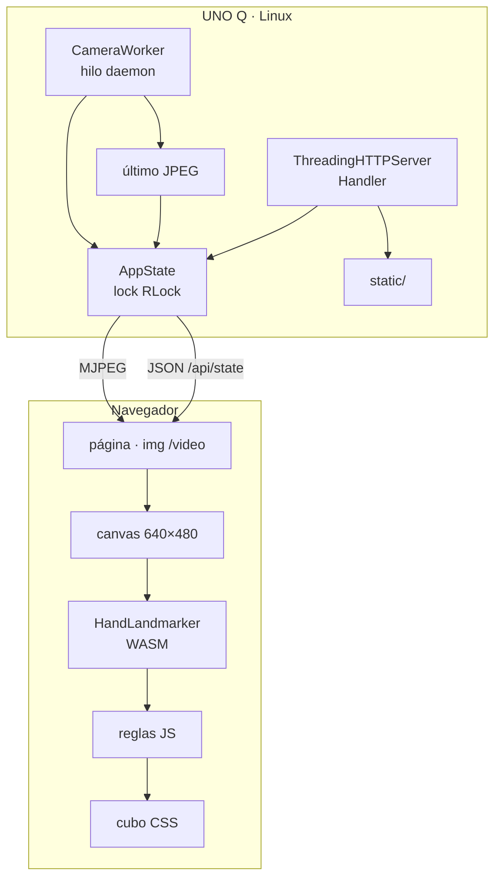

# GestureCube · Documentación de desarrollador

**Arquitectura, módulos, contratos y guía de extensión del proyecto GestureCube UNO Q.**

Versión 2.0 · Python 3.13 · MediaPipe Tasks Vision 1.2.3 · Debian 13.

---

## 1. Resumen y principios

GestureCube separa dos responsabilidades que suelen mezclarse:

1. **Adquisición y transporte** en la Arduino UNO Q: cámara UVC → V4L2 → OpenCV → JPEG → MJPEG por HTTP.
2. **Inferencia e interacción** en el navegador: `` MJPEG → canvas → MediaPipe HandLandmarker (WASM) → reglas geométricas → cubo CSS 3D.

Principios que guiaron el código:

- **Cero frameworks en la placa.** Solo stdlib + NumPy + OpenCV. Menos dependencias, menos RAM, arranque inmediato.
- **La placa no infiere.** El CPU QRB2210 no soporta los wheels nativos de MediaPipe (LSE); la inferencia vive en el cliente.
- **Offline real.** Runtime WASM y modelo versionados en `static/`; ninguna llamada a CDN en runtime.
- **Reglas explícitas.** Los gestos son geometría auditable, no una caja negra adicional.
- **Un solo estado compartido y locks.** El hilo de cámara y los hilos HTTP no se pisan.

---

## 2. Arquitectura



### Modelo de ejecución

| Componente | Tipo | Responsabilidad |
|---|---|---|
| `main()` | hilo principal | Parseo de args, engine opcional, signal handlers, `serve_forever` |
| `CameraWorker` | hilo daemon | Abrir cámara, leer frames, espejar, JPEG, overlay, reintentos |
| `ThreadingHTTPServer` | hilo principal + hilos por request | Servir estáticos, MJPEG, SSE, API |
| `AppState` | objeto compartido | Estado con `threading.RLock` |
| Navegador | proceso externo | Inferencia, reglas, animación |

No hay colas ni IPC: el estado se comparte en memoria. El JPEG se publica como `bytes` y cada cliente MJPEG lo lee bajo lock.

---

## 3. Mapa de archivos

| Archivo | Rol | Depende de |
|---|---|---|
| `app.py` | Servidor HTTP, cámara, API, estáticos | `gesture_engine`, OpenCV, NumPy |
| `gesture_engine.py` | Motor nativo de referencia | MediaPipe Python (opcional) |
| `static/index.html` | Estructura del panel | `style.css`, `app.js` |
| `static/style.css` | Tema, cubo 3D, responsive | — |
| `static/app.js` | Cubo, MediaPipe, reglas, UI | `vision_bundle.mjs` |
| `static/mediapipe/vision_bundle.mjs` | Runtime Tasks Vision 1.2.3 | WASM |
| `static/mediapipe/wasm/` | Backend WASM | — |
| `static/models/hand_landmarker.task` | Modelo float16 | — |
| `systemd/gesturecube.service` | Unidad de producción | `scripts/run-service.sh` |
| `scripts/run-service.sh` | Wrapper de arranque | `camera.env`, `.pylibs` |
| `scripts/install-service.sh` | Instalación | systemd |
| `scripts/status.sh` | Diagnóstico | systemd, curl |

---

## 4. Flujo de un frame

```text
CameraWorker.run()
  ├─ _open_camera()  (reintento cada 5 s si falla)
  ├─ cap.read() → frame BGR
  ├─ cv2.flip(frame, 1) si mirror
  ├─ [opcional] engine.process(frame) → manos + eventos
  ├─ _draw_overlay(frame, manos)
  ├─ cv2.imencode('.jpg', frame, calidad 82)
  ├─ STATE.set_frame(jpeg)
  ├─ STATE.set_hands(manos)
  ├─ STATE.set_gesture(manos)
  └─ sleep hasta 1/20 s
```

Del lado del navegador:

```text
  (MJPEG se actualiza solo)
  └─ rAF detectionLoop cada ~66 ms
       ├─ drawImage(img, canvas 640×480)
       ├─ handLandmarker.detectForVideo(canvas, now)
       ├─ processResult()
       │    ├─ invertir handedness si MIRROR_HANDEDNESS
       │    ├─ palmCenter / countExtended / classify
       │    ├─ processHand() → swipe + estable
       │    ├─ drawLandmarks()
       │    └─ updateHandHud()
       └─ FPS cada 1 s
```

---

## 5. `app.py`

### 5.1 `AppState`

Estado compartido con `RLock`. Campos:

| Campo | Tipo | Uso |
|---|---|---|
| `camera_ok`, `camera_name`, `camera_error` | bool/str | Estado de captura |
| `model_ok`, `model_error` | bool/str | Motor nativo opcional |
| `fps` | float | Suavizado exponencial (85/15) |
| `hands` | list[dict] | Manos del motor nativo |
| `gesture`, `spin` | str/bool | Estado de UI del servidor |
| `last_event`, `last_event_at`, `seq` | dict/float/int | Último evento y secuencia |
| `latest_jpeg`, `last_frame_at` | bytes/float | Frame publicado |
| `last_hand_at` | float | Para autostop de giro |

Métodos:

- `set_camera(ok, name, error)`: actualiza estado de cámara.
- `set_frame(jpeg, at)`: publica el último JPEG.
- `set_fps(fps)`: media suavizada.
- `set_hands(hands)`: serializa `HandState.to_dict()`.
- `set_gesture(hands)`: mantiene la acción visible 1,5 s; si no hay manos y `spin`, muestra `spin`.
- `push_event(action, hand, value)`: traduce gestos crudos a acciones y actualiza `last_event`/`seq`.
- `reset()`: apaga spin, vuelve a `idle`, emite evento `reset`.
- `snapshot()`: dict completo para `/api/state` y `/events`.

**Mapeo de `push_event`:**

| Crudo | Mano | Acción |
|---|---|---|
| `swipe_left` | Right | `rotate_left` |
| `swipe_left` | Left | `rotate_right` |
| `swipe_right` | Right | `rotate_right` |
| `swipe_right` | Left | `rotate_left` |
| `spin_start` | cualquiera | activa `spin` |
| `spin_stop` | cualquiera | desactiva `spin` |

### 5.2 `CameraWorker`

Hereda de `threading.Thread` (daemon). Ciclo:

1. `_open_camera()`:
   - Si hay `camera_spec`, intenta abrirlo tal cual (índice, `/dev/videoN` o URL).
   - Si no, escanea `/dev/video0..9`; lee `/sys/class/video4linux/videoN/name`; descarta nombres con `venus`, `encoder`, `decoder` o `qcom`; prueba abrir.
   - Si falla, publica placeholder y espera 5 s.
2. `_try_capture(spec)`:
   - `cv2.VideoCapture(spec, cv2.CAP_V4L2)` para índices; `cv2.VideoCapture(spec)` para URL.
   - Configura 640×480, 30 fps, `BUFFERSIZE=1`.
   - Lee un frame de prueba; si falla, libera y devuelve `None`.
3. Loop:
   - `cap.read()`; hasta 25 fallos consecutivos antes de reintentar apertura.
   - Espeja si `mirror`.
   - Si hay engine, procesa y publica eventos.
   - Dibuja overlay (esqueleto + etiqueta).
   - Codifica JPEG calidad 82.
   - Actualiza FPS y estado.
   - Autostop de giro si `spin` y no hay manos por >3,5 s (solo aplica al motor nativo).
   - Limita a 20 fps.
4. Al salir: libera `cap`, marca cámara desconectada y espera 2 s.

`_make_placeholder()` genera un frame 640×480 con rejilla, esquinas y texto "CAMARA USB NO DETECTADA". Se publica cuando no hay cámara.

`_draw_overlay()` dibuja `HAND_CONNECTIONS`, puntos y una etiqueta `MANO GESTO N dedos`.

### 5.3 `Handler`

`BaseHTTPRequestHandler` con `protocol_version = "HTTP/1.0"` y `server_version = "GestureCube/1.0"`.

Rutas GET:

- `/` y `/index.html` → `static/index.html`.
- `/static/<path>` → archivo dentro de `STATIC_DIR`.
- `/video` → MJPEG.
- `/events` → SSE con snapshot cada 250 ms.
- `/api/state` → `STATE.snapshot()`.
- `/healthz` → resumen.
- `/favicon.ico` → 204.

Rutas POST:

- `/api/demo/<acción>` → mapeo a `push_event` o `reset`.
- `/api/reset` → reset.

**Seguridad de estáticos:** `candidate = (STATIC_DIR / relative).resolve()` y `candidate.relative_to(STATIC_DIR.resolve())`; si falla, 403. No se sirve nada fuera de `static/`.

**MJPEG:** cabecera `multipart/x-mixed-replace; boundary=frame`, `Connection: close`; loop que escribe `--frame`, `Content-Type`, `Content-Length`, JPEG y `\r\n`; duerme 1/15 s; captura `BrokenPipeError`, `ConnectionResetError` y `OSError`.

**SSE:** `text/event-stream`, `retry: 2000`, snapshot cada 250 ms. La página actual no lo usa.

**MIME:** `mimetypes.guess_type`; `.mjs` y `.wasm` se sirven con su tipo; `.task` cae a `application/octet-stream`, suficiente para `fetch`/modelo.

### 5.4 `main()`

- Argumentos: `--host`, `--port`, `--camera`, `--model`, `--no-mirror`, `--debug`.
- `--camera` toma `GESTURECUBE_CAMERA` como default.
- Inicializa `AppState`.
- Si `MEDIAPIPE_AVAILABLE` y el modelo existe, crea `GestureEngine`; si no, deja `model_error` y sigue.
- Arranca `CameraWorker`.
- Crea `ThreadingHTTPServer` con `daemon_threads = True`.
- `SIGINT`/`SIGTERM`: setea `stop_event`, lanza `server.shutdown()` en un hilo.
- `finally`: detiene cámara, cierra engine y servidor.

**Invariante:** el servicio nunca muere por falta de MediaPipe, cámara o modelo. Todo fallo se refleja en el estado y se reintenta.

---

## 6. `gesture_engine.py`

### 6.1 Rol

Motor nativo de referencia basado en MediaPipe Tasks Python. **En la UNO Q no se carga** porque MediaPipe no está disponible para ese CPU; se conserva para:

- Documentar la lógica original.
- Servir en plataformas x86_64/aarch64 compatibles.
- Permitir pruebas de reglas sin navegador.

### 6.2 Importación tolerante

- Si `matplotlib` no está, inyecta un stub en `sys.modules` porque `mediapipe` lo importa desde `drawing_utils` aunque no se use.
- `try/except` alrededor de `mediapipe`; define `MEDIAPIPE_AVAILABLE` y `MEDIAPIPE_IMPORT_ERROR`.
- `GestureEngine.__init__` lanza `RuntimeError` si no está disponible.

### 6.3 Constantes

| Constante | Valor | Uso |
|---|---|---|
| `HAND_CONNECTIONS` | 21 pares | Esqueleto |
| `FINGER_TIPS` | 8, 12, 16, 20 | Puntas |
| `FINGER_PIPS` | 6, 10, 14, 18 | Articulaciones |
| `SWIPE_MIN_DX` | 0,17 | Desplazamiento mínimo |
| `SWIPE_WINDOW_S` | 0,60 | Ventana histórica |
| `SWIPE_COOLDOWN_S` | 0,90 | Cooldown |
| `SWIPE_MIN_SPEED` | 0,32 | Velocidad mínima |
| `STABLE_FRAMES` | 4 | Confirmación estática |

La referencia se toma a `0,75 × SWIPE_WINDOW_S` = 0,45 s, equivalente a la ventana del JS.

### 6.4 Dataclasses

- `HandState`: `handedness`, `score`, `landmarks`, `gesture`, `fingers`, `palm`; `to_dict()` redondea a 3/4 decimales.
- `GestureEvent`: `action`, `hand`, `value`, `timestamp`.

### 6.5 `process(frame_bgr, now)`

1. Convierte BGR→RGB con `np.ascontiguousarray(frame[:, :, ::-1])`.
2. Crea `mp.Image` SRGB.
3. `detect_for_video(image, timestamp_ms)` con timestamps monotónicos crecientes.
4. Por cada mano:
   - `handedness` y score.
   - Landmarks a tuplas `(x, y, z)`.
   - Palma = promedio de 0, 5, 9, 13, 17.
   - Dedos extendidos y clasificación.
   - `HandState` a la lista.
   - Track de palma (deque maxlen 48).
   - `_detect_swipe` y `_detect_static`.
5. Limpia tracks de manos ausentes >0,6 s.
6. Si el spin estaba activo y la mano derecha falta >1,2 s, emite `spin_stop`.
7. Devuelve `(hands, events)`.

### 6.6 Conteo y clasificación

```python
d_tip = |tip - wrist|
d_pip = |pip - wrist|
if d_pip > 1e-6 and d_tip > d_pip * 1.15:
    count += 1
```

`_classify`: `<=1` → `fist`; `>=3` → `open`; si no, `unknown`.

### 6.7 `_detect_static`

Máquina de estados por mano:

- Si el gesto es igual al anterior, incrementa `stable_count`; si cambia, reinicia a 1.
- Con `>= STABLE_FRAMES`:
  - `fist` + Right + no spin → `spin_start`, activa `_spin_active`.
  - `open` + spin activo → `spin_stop`, desactiva.

`mark_spin_stopped()` sincroniza cuando el servidor detiene el giro por otra vía.

### 6.8 `_detect_swipe`

- Solo con `gesture == "open"`.
- Respeta cooldown por mano.
- Necesita ≥5 muestras.
- Busca la muestra más antigua dentro de la ventana de 0,45 s.
- Calcula `dt`, `dx`, `dy`, `speed`.
- Exige `|dx| ≥ 0,17`, `|dx| > 1,45·|dy|`, `speed ≥ 0,32`.
- Dirección: `dx < 0` → `swipe_left`; si no, `swipe_right`.
- Setea cooldown, limpia track y emite evento.

### 6.9 Timestamps

`_next_timestamp_ms()` usa `time.monotonic() * 1000` y garantiza incremento estricto (`+1` si se repite or se atrasa), requisito de `detect_for_video`.

### 6.10 Diferencias con el motor JS

| Aspecto | Python | JS |
|---|---|---|
| Entrada | frame BGR de OpenCV | canvas del `` |
| Ventana | 0,60 s con referencia a 0,45 s | 0,45 s directa |
| Handedness | etiqueta nativa | invertida por espejado |
| Overlay | dibuja en el frame | dibuja en canvas aparte |
| Autostop | 1,2 s en el motor; 3,5 s en `CameraWorker` | 1,2 s |
| Uso en UNO Q | no | sí |

Mantener ambos motores sincronizados es deuda técnica conocida.

---

## 7. `static/app.js`

### 7.1 Módulo y constantes

```js
import { FilesetResolver, HandLandmarker } from "./mediapipe/vision_bundle.mjs";
```

- `CUBIE = 54`, `STEP = 58`: tamaño y separación de cubies.
- `COLORS`: frente rojo, atrás naranja, derecha verde, izquierda azul, arriba blanco, abajo amarillo.
- `FACES`: 6 caras con su transformación CSS y su criterio de cara externa.
- `HAND_CONNECTIONS`, `FINGER_TIPS`, `FINGER_PIPS`, `SWIPE_*`, `STABLE_FRAMES`: espejo del motor Python.
- `MIRROR_HANDEDNESS = true`: corrige la etiqueta por el espejado del servidor.

### 7.2 Cubo

`buildCube()` recorre `x, y, z ∈ {-1, 0, 1}`, omite el centro `(0,0,0)` y crea 26 cubies. Cada cubie tiene 6 caras:

- Caras externas: color + `boxShadow` interno.
- Caras internas: `INNER` y sin sombra.

Posición: `translate3d(x*58, y*58, z*58)`.

Animación:

```js
let yaw = -0.55, targetYaw = yaw, spinning = false;
const SPIN_SPEED = 1.55;
```

`tick(now)` corre con `requestAnimationFrame`:

- Si `spinning`, `yaw += SPIN_SPEED * dt` y `targetYaw = yaw`.
- Si no, interpola `yaw` hacia `targetYaw` con factor `min(1, dt*9.5)`.
- Aplica `rotateX(-22deg) rotateY(yaw rad)`.
- Añade un bob vertical con `sin(now/1500)`.

Los barridos hacen `targetYaw ±= π/2`; el giro continuo usa radianes por segundo.

### 7.3 Eventos y UI

`handleEvent(event)`:

- Actualiza `gestureHoldUntil` (1,5 s) para que el HUD no se pise.
- `rotate_left/right`: mueve `targetYaw`, ilumina la tarjeta correspondiente y etiqueta el escenario.
- `spin_start`: `spinning = true`.
- `spin_stop`: `spinning = false`, `targetYaw = yaw`.
- `reset`: apaga spin, vuelve a `-0.55`.
- Agrega una entrada al feed con hora local `es-AR`.

`addLog` crea items con barra de color, acción, mano y hora; mantiene los últimos 6.

`updateHandHud` muestra manos y gesto; respeta la ventana de 1,5 s.

### 7.4 Motor de gestos

`tracks` por mano: `{ samples, lastSeen, cooldown, stable, stableCount }`.

- `countExtended`: misma fórmula que Python (`dTip > dPip * 1.15`).
- `classify`: `<=1` fist, `>=3` open, resto unknown.
- `palmCenter`: promedio de 0, 5, 9, 13, 17.
- `processHand`:
  - Agrega muestra y limita a 48.
  - Si `open` y fuera de cooldown, busca referencia a 0,45 s y evalúa los cuatro criterios.
  - Si pasa, emite `swipe_left/right`, setea cooldown, limpia samples.
  - Actualiza estabilidad y, a los 4 frames, emite `spin_start` (fist derecho) o `spin_stop` (open con spin).
- `markHandMissing`: a los 0,6 s limpia track; a los 1,2 s corta spin derecho.
- `emitGesture`: traduce `swipe_*` + mano a `rotate_*`, igual que el servidor.

`processResult` recorre landmarks, invierte handedness si corresponde, calcula palma/dedos/gesto, alimenta `processHand`, dibuja y actualiza HUD.

### 7.5 MediaPipe

```js
const vision = await FilesetResolver.forVisionTasks("/static/mediapipe/wasm");
handLandmarker = await createLandmarker(vision, "GPU"); // fallback CPU
```

`createLandmarker(vision, delegate)`:

- `modelAssetPath: "/static/models/hand_landmarker.task"`
- `runningMode: "VIDEO"`
- `numHands: 2`
- confianza 0,55 en detección, presencia y tracking.

`initMediaPipe` maneja estados del pill: `CARGANDO` → `LISTO` / `ERROR`.

### 7.6 Loop de inferencia

- Canvas oculto 640×480, contexto `2d` con `willReadFrequently`.
- `detectionLoop` corre con `requestAnimationFrame`; sale temprano si no hay landmarker, cámara o `img` listo; gate de 66 ms (~15 fps).
- Copia el `` al canvas, llama `detectForVideo(canvas, now)`, calcula FPS cada segundo y procesa el resultado.
- Errores de inferencia se loguean una sola vez.

### 7.7 Estado del servidor y controles

- `pollServerState()` cada 1 s: `serverCamera`, nombre, clases del frame, reseteo de HUD.
- Botones `[data-demo]`: eventos locales en `DEMO_EVENTS`; no llaman a la API.
- `#fullscreen`: request/exit fullscreen.
- Teclado: `1`–`4`, `r`, `f`.
- `initMediaPipe()` al final del módulo.

**Detalle:** el cubo y los gestos funcionan aunque el servidor no tenga cámara; la página no depende de `/api/state` para animar.

---

## 8. Contrato HTTP

### `GET /api/state`

| Campo | Tipo | Notas |
|---|---|---|
| `ok` | bool | Siempre `true` si responde |
| `camera` | bool | Hay cámara abierta |
| `camera_name` | str | Dispositivo o URL |
| `camera_error` | str | Último error |
| `model` | bool | Motor nativo cargado |
| `model_error` | str | Motivo |
| `browser_model` | bool | Existe el `.task` |
| `fps` | float | Captura suavizada |
| `hands` | list | Solo motor nativo |
| `hand_count` | int | `len(hands)` |
| `gesture` | str | `idle`, `fist`, `open`, `rotate_*`, `spin` |
| `spin` | bool | Giro activo |
| `last_event` | object/null | Último evento |
| `seq` | int | Secuencia monotónica |
| `uptime` | int | Segundos desde el arranque |

### Códigos

- `200`: OK.
- `204`: favicon.
- `400`: acción de demo desconocida.
- `403`: path traversal.
- `404`: ruta o archivo inexistente.

### SSE `/events`

Envía `data: <snapshot>\n\n` cada 250 ms. No se usa en la página actual, pero permite integraciones que prefieran push a polling.

---

## 9. Máquina de estados del gesto

```text
        ┌──────────┐  swipe  ┌──────────────┐
        │  idle    │────────▶│ rotate_left  │
        └────┬─────┘         └──────────────┘
             │ swipe          ┌──────────────┐
             └───────────────▶│ rotate_right │
                              └──────────────┘
        puño derecho estable
             │
             ▼
        ┌──────────┐  palma / mano perdida
        │  spin    │────────────────────────▶ idle
        └──────────┘
```

En el servidor, `gesture` es solo informativo para la UI; en el navegador, el estado real del cubo es `spinning`, `targetYaw` y `yaw`. Los dos estados no están sincronizados: si se usa `/api/demo/*`, el servidor registra el evento pero el cubo del navegador no se mueve (los botones locales sí).

---

## 10. Decisiones e invariantes

| Decisión | Motivo |
|---|---|
| `http.server` y no FastAPI | Menos dependencias y RAM; el proyecto no necesita ORM ni validación |
| `HTTP/1.0` | Evita chunked y simplifica MJPEG/SSE |
| MJPEG y no WebRTC | Cero señalización, funciona en ``, latencia suficiente |
| Frame espejado en la placa | Reflejo natural; el overlay se dibuja sobre la misma imagen |
| Invertir handedness en JS | MediaPipe etiqueta sobre la imagen espejada |
| Modelo/WASM locales | Offline y privacidad |
| 26 cubies y no 27 | Se omite el cubie central invisible |
| Botones demo locales | La página se puede mostrar sin backend de eventos |
| Python + JS duplicados | Referencia y respaldo; el JS es el runtime real |

**Invariantes:**

- El servidor no muere por cámara ausente, modelo ausente o cliente que corta el stream.
- El estado compartido se lee/escribe bajo lock.
- Los estáticos nunca salen de `static/`.
- El cubo no depende de la cámara para animarse.

---

## 11. Guía de extensión

### 11.1 Agregar un gesto

1. Definir el evento crudo (por ejemplo, `two_fingers`).
2. En `app.js`: detectarlo en `processHand` o en una función nueva; emitir con `emitGesture`.
3. En `handleEvent`: mapear a una acción y animar el cubo.
4. En `AppState.push_event` (si se quiere reflejar en el servidor): mapear el crudo.
5. En `gesture_engine.py`: replicar la regla para mantener paridad.
6. Documentar en README, datasheet y developer.

### 11.2 Ajustar umbrales

- Navegador: constantes al inicio del bloque "Detección de gestos" en `app.js`.
- Python: `SWIPE_*`, `STABLE_FRAMES`, `1.15` en `_count_extended`.
- Cambiar `app.js` no requiere reiniciar; el servidor manda `no-cache`.
- Cambiar Python requiere `sudo systemctl restart gesturecube`.

### 11.3 Cambiar la fuente de cámara

- CLI: `--camera /dev/video2` o `--camera http://IP:8080/video`.
- Persistente: `camera.env` con `GESTURECUBE_CAMERA`.
- Para agregar otro tipo de fuente (RTSP), habría que adaptar `_try_capture`; OpenCV puede abrir RTSP, pero el proyecto solo documenta V4L2 y MJPEG HTTP.

### 11.4 Cambiar el cubo

- Colores: objeto `COLORS` en `app.js`.
- Tamaño: `--cubie` y `--step` en `style.css`; también `CUBIE`/`STEP` en JS (mantener sincronizados).
- Ángulo inicial: `yaw = -0.55` y `targetYaw`.
- Velocidad de giro: `SPIN_SPEED`.
- Para un cubo con estado real de piezas habría que reemplazar el modelo visual por uno con cubies agrupados por capas y animaciones de cara; es un cambio mayor.

### 11.5 Agregar un endpoint

1. Agregar la ruta en `Handler.do_GET` o `do_POST`.
2. Usar `_send_json` o `_send_text`.
3. Si modifica estado, hacerlo bajo `STATE.lock`.
4. Documentar en README y developer.

### 11.6 Usar SSE en el cliente

Reemplazar el polling de `pollServerState` por:

```js
const events = new EventSource("/events");
events.onmessage = (e) => {
  const state = JSON.parse(e.data);
  // actualizar UI
};
```

El servidor ya lo soporta; la página actual no lo usa para mantener el cliente simple.

### 11.7 Tests sugeridos

- **Reglas puras:** exportar `countExtended`, `classify` y la detección de swipe a un módulo testeable; alimentar landmarks sintéticos.
- **Servidor:** `python3 -m py_compile app.py gesture_engine.py`; `curl /healthz`; `curl -I` de estáticos.
- **JS:** `node --check static/app.js`.
- **Integración:** Chromium headless con `--dump-dom` y buscar `model-pill-text` = `LISTO`.
- **Hardware:** `ls /dev/video*`, `cv2.VideoCapture`, abrir `/video` en VLC.

Comando de verificación usado en el proyecto:

```bash
python3 -m py_compile app.py gesture_engine.py
node --check static/app.js
curl -fsS http://127.0.0.1:8091/healthz
curl -fsS -o /dev/null -w '%{http_code}\n' http://127.0.0.1:8091/
curl -fsS -o /dev/null -w '%{http_code}\n' http://127.0.0.1:8091/static/mediapipe/vision_bundle.mjs
```

Prueba de carga de MediaPipe en la placa con Chromium headless:

```bash
TMPDIR=/dev/shm XDG_RUNTIME_DIR=/dev/shm \
chromium --headless=new --no-sandbox --disable-gpu --disable-dev-shm-usage \
  --enable-unsafe-swiftshader --user-data-dir=/dev/shm/chrome-test \
  --virtual-time-budget=25000 --dump-dom http://127.0.0.1:8091/
```

### 11.8 Despliegue

```bash
# Copiar archivos a la placa
scp app.py gesture_engine.py requirements.txt arduino@IP:/home/arduino/GestureCubeUNOQ/
scp -r static scripts systemd arduino@IP:/home/arduino/GestureCubeUNOQ/
sudo systemctl restart gesturecube
```

Si cambia la unidad: `sudo ./scripts/install-service.sh`.

---

## 12. Deuda técnica y rarezas conocidas

- **Umbrales duplicados** en JS y Python; no hay una fuente única de verdad.
- **Dos motores** con diferencias menores de ventana y autostop.
- **SSE sin cliente**; el endpoint existe y funciona, pero la página usa polling.
- **Botones demo locales** no llaman a `/api/demo/*`; el servidor y el cubo pueden desincronizarse si se mezclan.
- **Sin tests automatizados**; la verificación es manual/CLI.
- **Sin TLS ni auth**; es una demo de LAN.
- **`model` siempre `false`** en `/healthz` en esta placa; puede confundir a quien no leyó el README.
- **El cubo no mantiene estado de piezas**; es visual.
- **El placeholder se genera con OpenCV**; si OpenCV falta, no hay frame y el `` queda vacío.
- **El escaneo de cámara es heurístico** (nombre del nodo); una cámara UVC con nombre raro podría quedar afuera. `--camera` lo evita.

---

## 13. Rendimiento y límites

| Recurso | Límite | Dónde |
|---|---|---|
| Captura | 20 fps | `CameraWorker.run` |
| Stream | 15 fps | `_stream_video` |
| Inferencia | ~15 fps | gate 66 ms |
| Manos | 2 | `numHands` |
| JPEG | q=82 | `imencode` |
| Canvas | 640×480 | `workCanvas` |
| Modelo | ~7,5 MB | `.task` |
| WASM | ~29 MB | `static/mediapipe` |

El servidor no ejecuta la red; su costo es captura + JPEG + HTTP. El navegador es el que carga con la inferencia. Si se necesita más FPS, el primer cuello es el ancho de banda del MJPEG y la inferencia del cliente, no la UNO Q.

---

## 14. Referencias internas

- [`README.md`](../README.md) — visión general, instalación y operación.
- [`datasheet.md`](datasheet.md) — manual de usuario.
- [`REFERENCES.md`](REFERENCES.md) — enlaces externos comentados.
- `static/mediapipe/README.md` — origen y licencia del runtime.
- `static/models/README.md` — origen y licencia del modelo.

---

*GestureCube · documentación de desarrollador · licencia MIT © 2026 Jose Manuel Adasme.*
